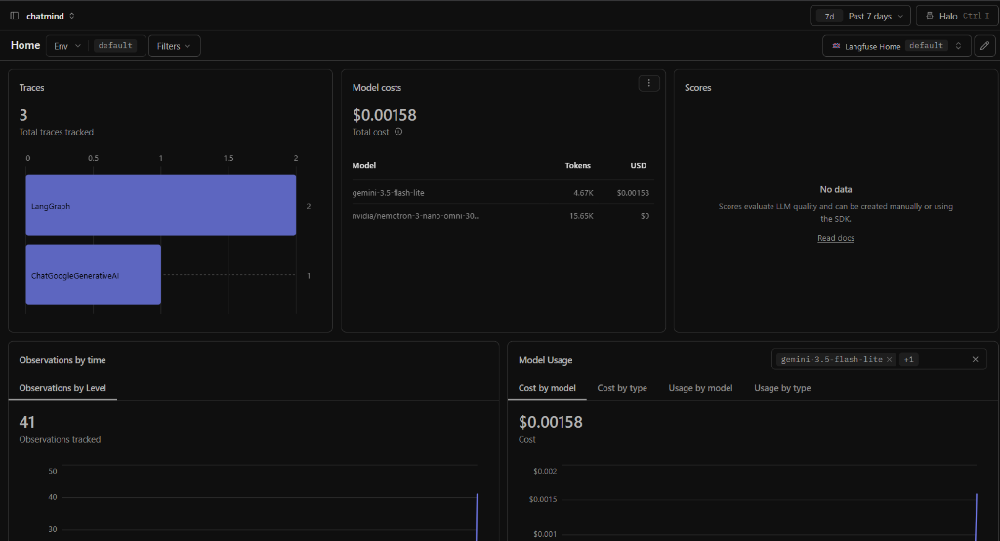
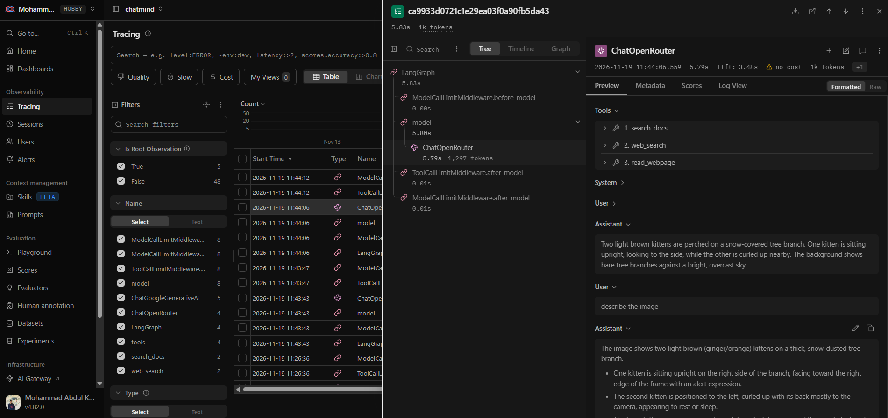

# ChatMind 🧠✨

> **An Intelligent Conversational AI Assistant & Research Hub**  
> Chat with your local documents (`.pdf`, `.txt`, `.md`) and the live web. Scoped project workspaces, automated RAG synthesis, interactive tool tracing, prompt library, and exportable PDF executive briefs.

---

## 📸 Overview & Design System

ChatMind features a warm, minimalist aesthetic inspired by modern creative studios:

- **Light Theme**: Soft warm cream (`#FAF7F2`), delicate borders, and terracotta accents (`#E07A5F`).
- **Dark Theme**: Deep espresso charcoal (`#141210`), warm dark cards (`#201A16`), and amber glow.
- **Adaptive Responsiveness**: Tailored desktop workspace with sidebar panels, plus a seamless mobile app experience with bottom navigation and drawer menus.

```
chatmind/
├── assets/           # Project screenshots, architecture & observability traces
├── backend/          # FastAPI + LangChain/LangGraph Agent + RAG
│   ├── app/          # API routes, Core LLM/RAG logic, Services
│   ├── data/         # SQLite DB, checkpoints, and Chroma vector store
│   └── requirements.txt
├── frontend/         # React (Vite) + Tailwind CSS + Lucide
│   ├── src/          # Responsive UI views, components, SSE client
│   └── package.json
└── README.md
```

---

## ✨ Features

- ⚡ **Dual AI Engine Support (Google Gemini + OpenRouter)**:
  - **Google Gemini Direct API**: Lightning-fast streaming with `gemini-3.8-flash` and `gemini-2.5-pro` (1,500 free requests/day).
  - **OpenRouter Multi-Vendor Pool**: Broad model catalog (`nvidia/nemotron-3.5-super-vl:free`, `cohere/north-mini-code:free`, etc.).
  - **Smart Rate Limit Detection & 1-Click Failover**: Automatic detection of `free-models-per-day` quota exhaustion with an in-chat alert banner and 1-click switch to Gemini.
- ⚡ **Real-time SSE Streaming**: Low-latency token streaming with live tool call steps, latency benchmarks, and token counts.
- 🔍 **Full-Stack LLM Observability (Langfuse)**: End-to-end execution flame graphs, tool latency metrics, token expenditures (USD), and multi-turn session tracking.
- ⚡ **2-Stage Retrieval & Local Cross-Encoder Reranking (FlashRank)**: ChromaDB vector search pulls broad candidates (`fetch_k=12`) re-ranked by an ultra-lightweight ONNX cross-encoder (`ms-marco-TinyBERT`) in <10ms on CPU before prompt assembly.
- 📎 **Interactive Document & Pasted Cards**: Attached PDFs, documents, images, and large code snippets display as interactive pills inside the input area with real-time status and ready-for-Q&A indicators.
- 📋 **Claude-Style Pasted Snippet Cards**: Pasting large code (>12 lines) automatically collapses into an interactive pill widget with line/KB indicators and a dedicated preview modal before sending.
- 🗄 **Universal Knowledge Vault**: Dedicated browser for all uploaded assets categorized by **Large Code**, **Images**, and **PDF Documents**.
- 🤖 **Interactive Reasoning Traces**: Expandable _"Thought for X.Xs • Y steps"_ containers exposing exact search queries and tools executed.
- 📄 **Universal Document Ingestion**: Upload `.pdf`, `.txt`, `.md` files or index live Web URLs into isolated vector stores.
- 🔍 **Hybrid Retrieval-Augmented Generation (RAG)**:
  - Semantic vector search using local HuggingFace embeddings (`BAAI/bge-small-en-v1.5`).
  - Chroma vector database scoped strictly per project workspace.
  - Multi-tier web search fallback (Tavily API with DuckDuckGo fallback).
- 🔬 **Research Hub & AI Synthesis**:
  - Live metric cards (Sources count, Zero-hallucination Confidence score, Indexed Chunks, Priority).
  - One-click multi-source synthesis extracting numbered findings with traceable citations.
  - Professional PDF export generated with ReportLab.
- 💡 **Curated Prompt Library**:
  - Pinned favorites (_Smart Summarizer_, _Code Assistant_, _Study Partner_, _Idea Spark_).
  - Specialized domain assistants (_Literature Reviewer_, _Socratic Writing Coach_, _Clean Architecture Refactor_, _Financial Analyst_, etc.).
  - Search, filter by category, pin, run straight into chat, or build custom prompts.
- 🗂 **Conversation Memory**: Persistent multi-session threads backed by SQLite checkpointing (`checkpoints.db`).
- 🌓 **Instant Theme Switching**: Warm Cream Light Mode & Espresso Dark Mode, persisted to `localStorage`.

---

## 📊 Feature Status

| Module               | Feature                                                                     | Status        |
| :------------------- | :-------------------------------------------------------------------------- | :------------ |
| **Model Providers**  | Google Gemini Direct API (`gemini-3.5-flash`, `gemini-3.5-flash-lite`)      | ✅ Completed  |
| **Model Providers**  | OpenRouter Multi-vendor API (`nemotron-3.5`, `north-mini-code`)             | ✅ Completed  |
| **Model Providers**  | Daily Quota Exceeded SSE event (`limit_exceeded`) & 1-click failover banner | ✅ Completed  |
| **Chat & Agent**     | SSE streaming (`POST /chat`) & Live tool process tracing                    | ✅ Completed  |
| **Chat & Agent**     | Instant generation cancel / Stop button (`AbortController`)                 | ✅ Completed  |
| **Chat UI**          | Claude-style pasted snippet collapsible cards & preview modal               | ✅ Completed  |
| **Chat UI**          | Multimodal Vision (clipboard image paste & upload preview)                  | ✅ Completed  |
| **Knowledge Base**   | Document uploading & Knowledge Vault (Code, Images, PDFs)                   | ✅ Completed  |
| **Knowledge Base**   | Local vector embeddings (`bge-small-en-v1.5`) & Chroma                      | ✅ Completed  |
| **Research Hub**     | Workspace scoping, AI Key Findings synthesis & PDF export                   | ✅ Completed  |
| **Prompt Library**   | Pinned favorites, category filters & custom prompt creator                  | ✅ Completed  |
| **History**          | Persistent thread management, rename & delete                               | ✅ Completed  |
| **Frontend UI**      | Responsive desktop & mobile views matching design mockups                   | ✅ Completed  |
| **Frontend UI**      | Light (Cream) & Dark (Espresso) theme support                               | ✅ Completed  |
| **Observability**    | End-to-end LLM session tracing, latency & USD token costs (Langfuse)        | ✅ Completed  |
| **Retrieval Engine** | 2-Stage RAG: ChromaDB + FlashRank local cross-encoder reranking             | ✅ Completed  |
| **RAG Evaluation**   | Automated Faithfulness & Relevance benchmark suite (`ragas`)                | ⏳ In Roadmap |

---

## 🗺️ Production AI Engineering Roadmap (Planned Additions)

> [!NOTE]
> **Developer Roadmap Note**: This section tracks planned enterprise-grade enhancements to transform ChatMind into an industry-standard, observable AI platform. _Remove or update this note once each feature is implemented and tested._

### 1. 🔍 LLM Observability & Session Tracing (Langfuse)

- **Objective**: Gain deep visibility into multi-turn agent runs, flame graphs for tool executions, prompt latency benchmarks, and exact token costs (USD) per session.
- **Technology**: [Langfuse](https://langfuse.com/) (Hobby Free Tier) / OpenTelemetry SDK.
- **Key Metrics**: Time to First Token (TTFT), step execution latency, input/output token cost analysis, and upstream error logging.
- **Status**: ✅ **Completed**
- **Live Trace Sample**: [View Execution Trace on Langfuse Cloud](https://us.cloud.langfuse.com/project/cmwm01ju501dmad0e0gfslhxg/traces/ca9933d0721c1e29ea03f0a90fb5da43)

#### Langfuse Analytics Dashboard & Cost Breakdown


#### Multi-Turn Agent Step Trace & Flame Graph


### 2. ⚡ 2-Stage Retrieval & Local Cross-Encoder Reranking (FlashRank)

- **Objective**: Eliminate naive RAG vector search blindspots (semantic drift, acronyms, exact dates, domain keywords) by pulling candidate chunks from ChromaDB and re-ordering them with a local cross-encoder before LLM injection.
- **Architecture**:
  1. **Stage 1 (Bi-Encoder Candidate Retrieval)**: Dense vector search over ChromaDB fetches broad candidates (`fetch_k = 12`) via cosine similarity with `BAAI/bge-small-en-v1.5`.
  2. **Stage 2 (Cross-Encoder Re-ranking)**: `FlashRank` (`ms-marco-TinyBERT-L-2-v2`, 4MB quantized ONNX model) performs deep query-chunk token interaction scoring in <10ms on CPU.
  3. **Stage 3 (Precision Context Assembly)**: The top `k` reranked chunks are returned with verified relevance scores attached to metadata (`doc.metadata["rerank_score"]`).
- **Benefits**: Zero external API calls, 100% free & local execution, sub-10ms CPU latency, higher precision-at-k (P@k), and reduced context window bloat.
- **Status**: ✅ **Completed & Unit-Tested** (`pytest backend/tests/test_rag_rerank.py`)

### 3. 🧪 Automated RAG Evaluation Suite (Ragas)

- **Objective**: Quantify and validate RAG accuracy using mathematical metrics to prevent hallucinations and measure pipeline improvements over time.
- **Technology**: `ragas` with Google Gemini 3.5 Flash Lite acting as the judge evaluator.
- **Key Metrics**:
  - **Faithfulness**: Verifies answers are grounded strictly in retrieved documents (0.0 to 1.0).
  - **Answer Relevance**: Measures how directly the response addresses the prompt.
  - **Context Precision**: Confirms top-ranked chunks contain the ground-truth answers.
- **Deliverable**: Automated test script generating a benchmark score table for repository documentation.
- **Status**: 📋 _Planned (100% Free)_

---

## 🛠 Tech Stack

| Layer                | Technologies                                                                             |
| :------------------- | :--------------------------------------------------------------------------------------- |
| **Frontend**         | React 19, Vite, Tailwind CSS v4, Lucide Icons, React-Markdown, Remark-GFM                |
| **Backend API**      | FastAPI, Uvicorn, SQLAlchemy 2.0, SQLite (WAL mode), Pydantic v2                         |
| **AI Orchestration** | LangChain Core, `langchain-google-genai`, `langchain-openrouter`, LangGraph Checkpointer |
| **Vector Engine**    | ChromaDB, HuggingFace Transformers (`BAAI/bge-small-en-v1.5`)                            |
| **Reranking Engine** | FlashRank Local Cross-Encoder (`ms-marco-TinyBERT-L-2-v2` ONNX, <10ms CPU)               |
| **Observability**    | Langfuse v5 (End-to-end Tracing, Session Cost Analysis, Latency Flame Graphs)            |
| **Web & Ingestion**  | PyPDF, BeautifulSoup4, DuckDuckGo Search (`ddgs`), Requests, ReportLab                   |

---

## 🚀 Quick Start Guide

### Prerequisites

- **Node.js** v18+ and **npm** v9+
- **Python** 3.11, 3.12, 3.13, or 3.14
- A **Google AI Studio Key** (`GOOGLE_API_KEY`) and/or **OpenRouter API Key** (`OPENROUTER_API_KEY`)

---

### 1. Backend Setup

```powershell
# Navigate to backend directory
cd backend

# Activate existing virtual environment
.\.venv\Scripts\Activate.ps1

# Install dependencies
pip install -r requirements.txt

# Configure environment
copy .env.example .env
```

Ensure your `backend/.env` contains your API keys:

```env
# Google Gemini Direct (1,500 requests/day free tier)
GOOGLE_API_KEY=your_google_ai_studio_key_here

# OpenRouter (Multi-model free tier)
OPENROUTER_API_KEY=your_openrouter_api_key_here

# App Defaults
DEFAULT_MODEL=gemini-3.5-flash
EMBEDDING_MODEL=BAAI/bge-small-en-v1.5
DATABASE_URL=sqlite:///./data/app.db
CHROMA_DIR=./data/chroma_db
UPLOAD_DIR=./data/uploads
CORS_ORIGINS=http://localhost:3000,http://localhost:5173,http://127.0.0.1:3000,http://127.0.0.1:5173
```


Start the FastAPI backend server:
```powershell
uvicorn app.main:app --reload --reload-dir app --port 8000
````

> The API will be available at `http://localhost:8000`. Interactive Swagger documentation is at `http://localhost:8000/docs`.

---

### 2. Frontend Setup

In a new terminal window:

```powershell
# Navigate to frontend directory
cd frontend

# Install dependencies (if not already installed)
npm install

# Start Vite development server
npm run dev
```

> The web application will launch at **`http://localhost:3000`** (or `http://localhost:5173`).

---

## 📡 API Reference Summary

### Chat Stream

- **`POST /chat`**: Streams Server-Sent Events (SSE).
  ```json
  {
    "message": "Explain React hooks in simple words",
    "thread_id": "optional-uuid",
    "project_id": "default",
    "model": "nvidia/nemotron-3.5-super-vl:free",
    "allow_web": true
  }
  ```
  **Events emitted**:
  - `event: thread` -> `{"thread_id": "..."}`
  - `event: step` -> `{"tool": "search_docs", "args": {"query": "..."}}`
  - `event: token` -> `"text chunk"`
  - `event: limit_exceeded` -> `{"provider": "OpenRouter", "reason": "daily_free_limit", "alternative": "gemini-3.8-flash"}`
  - `event: done` -> `{"seconds": 1.4, "steps": 2, "usage": {"total_tokens": 320}}`
  - `event: error` -> `"Error description"`

### Documents & Knowledge Base

- **`POST /documents`**: Upload file (`multipart/form-data` with `file`, `project_id`).
- **`POST /documents/url`**: Index a web article `{"url": "...", "project_id": "..."}`.
- **`GET /documents?project_id={pid}`**: List documents with chunk counts and index status (`indexed`, `indexing`, `failed`).
- **`DELETE /documents/{id}`**: Delete document file and Chroma embeddings.

### Research Hub & Projects

- **`GET /projects`**: List all research workspaces.
- **`POST /projects`**: Create new project workspace.
- **`GET /projects/{pid}/stats`**: Source count, indexed count, and total chunk numbers.
- **`POST /projects/{pid}/synthesis`**: Trigger structured multi-document synthesis.
- **`POST /projects/{pid}/export`**: Download styled PDF research brief with citations.

### Prompt Library

- **`GET /prompts?q=&category=&pinned=`**: Search and filter prompts.
- **`POST /prompts`**: Create a custom prompt.
- **`POST /prompts/{id}/pin`**: Toggle favorite star pin.
- **`DELETE /prompts/{id}`**: Remove custom prompt.

---

## 🔒 Security & Privacy

- **Isolated Projects**: Documents are strictly partitioned by `project_id` in both SQLite and Chroma metadata filters.
- **Private Conversations**: Session history remains on your local machine (`checkpoints.db`).
- **Web Sandboxing**: Web browsing can be toggled on/off directly from the input bar.

---

## 📄 License

MIT License. Built with ❤️ for productive AI exploration.
